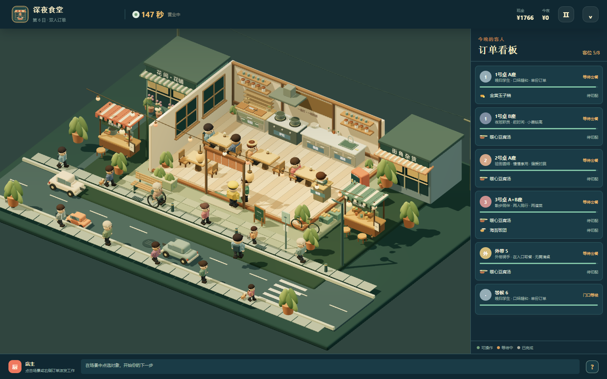

# 深夜食堂 · 一盏灯，一碗热饭

基于 Three.js 的等距低多边形 3D 夜市食堂经营浏览器游戏。玩家接手一间街角小食堂，在十个营业日中完成接待、切配、加热、装盘、送餐、结账和清洁，靠采购、扩建、设备和伙伴安排把一盏灯经营成街坊愿意绕路而来的地方。

源码仓库：[Mesting42/midnight-canteen](https://github.com/Mesting42/midnight-canteen)。



## 运行

需要 Node.js 20+。首次运行在项目目录执行：

```powershell
git clone https://github.com/Mesting42/midnight-canteen.git
cd midnight-canteen
npm install
npm run start
```

`start` 会检测从 4173 开始的空闲端口，启动 Vite，打印电脑地址和本机局域网地址，不修改防火墙，也不终止其他服务。开发模式使用 `npm run dev`，生产构建使用 `npm run build`，构建预览使用 `npm run preview`。

主游戏由 `src/scene.js`、`src/models.js` 和 `src/exterior.js` 使用 Three.js 几何搭建，包括木质食堂、低多边形人物、餐点、夜市摊位、轮椅长者、宠物与车辆；主场景不依赖远程图片或模型。`assets/painted/` 和 `src/comic-scene.js` 是早期 2D 手绘实验，不接入当前经营画面；`src/motion-atlas.js` 只用于素材预览和该实验场景。相关素材及开源来源随项目保留。Three.js 许可证位于 `node_modules/three/LICENSE`。声音由 `src/audio.js` 使用浏览器 Web Audio 合成。

仓库保留源码、测试、解压后的素材、素材授权、交接文档和验证截图；不提交 `node_modules/`、`dist/`、本地服务信息与日志，以及重复的原始素材 ZIP 下载包。下载包的来源和 SHA-256 仍记录在 `assets/open-source/catalog.json` 中。若需重新运行 `scripts/catalog-open-assets.mjs`，请先按 [素材核实记录](docs/OPEN_ASSET_RESEARCH.md) 恢复 `assets/open-source/downloads/` 下的原始 ZIP；正常运行、构建和素材预览不需要这些 ZIP。

## 操作与玩法

- **首次游玩**：首次新开游戏会自动进入操作式引导，分为备料开门、接待、做菜、送餐用餐、收款清桌五组。暖黄色实心箭头指向当前目标，轻微上下浮动，没有描边；暂停或减少动效时停止浮动。完成真实操作后再进入下一步，也可以点击引导里的操作按钮。练习期间暂缓后续客流，第一位客人不会因阅读提示而失去耐心，营业倒计时也不会消耗。支持跳过、刷新后继续，以及从准备页“新手手册”或营业页 `?` 重新练习。完成或跳过后，同一浏览器不会在每次新开游戏时重复弹出。
- **准备阶段**：在“菜单与备料”选择 1–4 道菜，点击库存采购；“补足建议”按预计客流采购。“设备升级”和“伙伴安排”改变真实工作效率。
- **营业阶段**：点击入口客人接待，点击切配台消耗库存；需要加热的料理点击炉灶，完成后点击装盘台，再点击对应订单或桌位送餐。用餐结束的客人需要结账，离店后的脏桌需要清洁。营业时间结束后停止接待新客，已接待的客人完成订单和结账后再进行日结；若库存不足以制作未完成的订单，会提示客人离开，避免日结卡住。
- **队列**：底部显示店主当前工作和未开始的指令；点队列里的 `×` 可取消未开始任务。炉位、桌位和订单都只允许一个有效占用。
- **暂停**：点击顶部暂停。暂停会冻结耐心、烹饪、顾客移动和声音；后台切换不惩罚营业时间。
- **手机和平板**：手机以横屏营业，同时查看 3D 餐厅、订单栏与任务队列；底部“切配、上锅、装盘”可直接派发厨房工作，客人接待、送餐和收款也可通过订单卡操作。菜单、备料、设置和日结支持手机竖屏；营业中转为竖屏会暂停计时、料理与客人耐心，横放后继续。点击“进入横屏游玩”会在浏览器允许时请求全屏并锁定横屏，不支持时请手动旋转。平板横屏与竖屏均可营业，触控按钮保留至少 44×44 像素点击区域。
- **设置**：主菜单、准备阶段和营业阶段都可以打开设置，调整音乐、工作音效、画质、辅助慢速、减少动效，并重新请求横屏。设置实时生效并随本地存档保存。
- **存档**：准备阶段、营业中、日结和结局都会自动保存；顶部保存按钮可手动保存。存档有版本号、校验和错误提示，营业中的顾客、桌位、料理进度与任务队列都会保存。
- **失败重试**：未达成营业额、正确订单数或满意度时，在日结页重试当前日，会回到该日开店前快照，不重复扣除采购、升级、工资或收款。
- **战役结局**：第十日完成后显示总报告，可继续自由营业或新开一档。自由营业保留成长记录和菜单，可继续在准备阶段调整。

## 顾客与街景

顾客从夜市街巷走向正门外的固定队列，接待前不会进入店内，前方有人被接待后会在门外补位。堂食顾客被接待后必须经过门洞，再绕开餐桌走到实际椅子的位置，转向桌面并切换坐姿；每把椅子都有独立状态与订单，双人顾客分别入座。餐点送到后会出现端碗与筷子用餐姿态；进食时餐盘里的食物逐渐减少。收款后客人起身，经正门回到街巷。店主在门内侧边接待，让出进店通道；送餐后退回厨房待命。脏餐具会保留到清洁完成，并提示待结账、待收盘和被脏桌阻塞的接待。外带顾客在正门外取餐，不占座。旧存档路线迁移保留原有现金、订单和库存。

店外是有暖色灯笼和摊位的夜市街巷，包含邻里店面、花摊、果摊、长椅、路灯、斑马线与双向车流。行人包含不同年龄与衣着，其中有坐轮椅的长者，部分行人带猫狗。高画质显示十二位行人和三辆车；低画质保留四位行人与三辆车。暂停和减少动效偏好继续生效。

营业时保留同一个画布和资源对象，只更新订单、人物状态与图层排序。点选区域对应实际绘制出来的人物、餐桌和工作台，订单栏仍可操作相同目标。

## 工作动作与食物流转

玩家仍按原来的切配、上锅、装盘、送餐、收款和清洁按钮操作，每一步内部自动完成。人物会随实际步骤切换持刀、搅拌、记录点单、端盘、擦拭和洗碗姿态。3D 餐点在备料盘、锅、出餐台、持物位置和餐桌间流转；加热时显示蒸汽，用餐时餐点逐渐变少。外带餐交给门外客人后会随客人一起离开。

每个订单的食物位置和携带者由经营引擎保存，食材在取料时扣除一次。煮熟的菜在盛出前仍占炉位，废弃料理会释放占用。清洁收起碗碟后，桌面随之清空，人物端碗去水槽。画面重绘保留原有任务时长、点击节奏和存档格式。

## 十日目标

第 1–3 日教学基础饭团、豆腐汤、玉子烧与雨夜耐心；第 4 日开放服务员，第 5 日增加外带，第 6 日引入双人组合订单，第 7 日开放清洁员，第 8 日为街区灯会，第 9 日开放双拼便当，第 10 日综合考验。每日日结展示营业额、食材成本、工资、利润、正确订单、流失顾客和满意度。

## 验证

```powershell
npm test
npm run test:campaign
npm run build
```

批量浏览器回归建议先在终端 A 启动专用测试服务（默认 4175，关闭测试期间不需要的开发热更新连接）：

```powershell
npm run test:serve
```

再在终端 B 将 `4175` 换成终端 A 打印的端口，运行浏览器回归：

```powershell
$env:PORT='4175'
npm run test:browser
npm run test:responsive
npm run test:service
npm run test:entrance
npm run test:workflow
```

`test:campaign` 用固定种子、真实公开操作和 0.1 秒步进跑两种可通关升级路线（厨房路线、伙伴路线），中途还会序列化/反序列化营业存档并检查库存、炉位、桌位和任务占用不变量；报告写入 `docs/campaign-simulation.json`。`test:browser` 使用 Chromium 检查菜单、准备页、可见 Three.js 夜市场景、开门营业、手机横屏/竖屏提示和平板双方向，并保存截图到 `docs/browser-*.png`。这些是无头浏览器与逻辑模拟范围，不替代所有实体手机型号的真机测试。

`test:service` 默认连接 `http://127.0.0.1:4174/`（可用 `PORT` 覆盖），通过隔离浏览器上下文完成第一单，同时检查坐姿与步态、轮椅手臂和轮圈、车辆朝向与滚轮、碗筷动画、支付/清桌提示、平板双方向与手机横屏、引导记录和重放。测试不会读取或改写其他浏览器上下文中的存档。截图写入 `docs/service-*.png`，检查报告写入 `docs/service-browser-report.json`。

`test:responsive` 默认连接 4173 端口，在 14 个独立视口中检查电脑、手机横竖屏、平板横竖屏与手机浏览器栏压缩后的布局。它验证 44 像素触控区域、画布与订单边界、完整手机切配/加热/装盘/送餐/结账/清桌、手机旋转暂停与恢复、平板旋转保留订单，以及采购、设置、教程和日结按钮的实际操作；截图和报告输出到 `docs/responsive-verified/`。中断后可用 `npm run test:responsive -- --resume` 续跑；脚本会确认界面源码未改变，避免复用过期结果。

`test:entrance` 同样默认连接 4174 端口，加载一个独立的排队场景，通过真实订单按钮接待单人、外带和双人顾客，逐渲染帧记录轨迹，检查所有堂食人物都从正门跨越店面前沿、排队和外带等待始终位于门外。报告和截图保存为 `docs/entrance-*`。

`test:workflow` 加载独立的动作存档帧，检查取料、切配、搬运、下锅、盛出、装盘、送餐、擦桌和清洗的工具与道具位置，并在运行中的页面采样箭头位置，验证浮动、无描边、暂停和减少动效行为。包含 2048px 桌面与 844×390 横屏、竖屏提示的检查。它使用隔离的浏览器存储，不覆盖玩家存档。报告与截图保存为 `docs/workflow-*`。设置环境变量 `RECORD_WORKFLOW=1` 后运行 `test:service` 可同时录制实际点击的完整第一单，输出 `docs/workflow-service.webm`，首次录制需 `npx playwright install ffmpeg`。

## 项目结构

- `src/data.js`：十日目标、十道原创料理、原料、顾客类型、升级和员工数据。
- `src/engine.js`：移动寻路、订单状态机、真实原料扣除、炉位/桌位占用、结算、存档和不变量。
- `src/models.js` / `src/scene.js` / `src/exterior.js`：低多边形人物与动作、料理、食堂、夜市街景、车辆、灯光与交互命中区。
- `src/workflow.js` / `src/actions.js`：分阶段工作计划、持物归属、厨房道具和与工作进度同步的动作。
- `src/exterior.js`：邻居店铺、街道设施、路人和店外街景。
- `src/tutorial.js`：操作式引导、完成记录、当前目标与练习期间的计时保护。
- `src/main.js` / `src/style.css`：准备、营业、日结、结局、响应式界面和设置。
- `src/audio.js`：本地 Web Audio 音乐与工作音效。

<!-- pixel-pier-game-listing:start -->
## Game listing / 游戏展示

- **Game developer / 游戏开发者:** Mest ([@Mesting42](https://github.com/Mesting42))
- **Pixel Pier listing / 游戏展示页面:** [Midnight Canteen](https://riverglint.link/games/midnight-canteen/)

This game is listed on Pixel Pier with a play entry and game guide. This link identifies a game-development and listing relationship; it does not identify the developer as the website operator or operating entity.

本游戏在 Pixel Pier 展示，并提供游玩入口与游戏指南。此链接仅表示游戏开发与展示关联，不代表开发者是该网站的运营者或运营主体。
<!-- pixel-pier-game-listing:end -->
