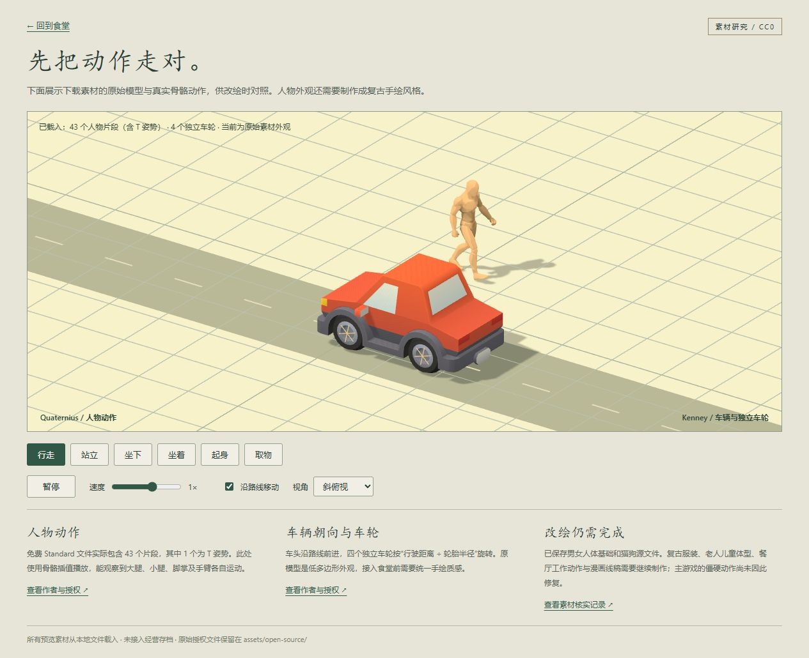

# 免费开放素材核实记录

核实日期：2026-10-18。目标是为《深夜食堂》补齐真实动作基础，最终外观仍按用户提供的复古手绘、斜俯视参考制作。

## 结论

本次筛选没有找到可直接替换、同时覆盖中国复古商场、餐厅、老少男女、猫狗以及完整动画的一整套开放素材。已找到并下载允许修改和商用的 CC0 人物、动作、车辆和动物基础。

这批素材原本是 3D 模型。它们可以用于研究和制作动作、再绘制或渲染为 2D 序列帧。下载这些素材不会自动让外观接近参考图，也不会自动修复主游戏动画。

## 实际下载内容

| 素材 | 作者与原页 | 本地核实结果 | 需要补做 |
| --- | --- | --- | --- |
| Universal Animation Library **Standard** | [Quaternius](https://quaternius.itch.io/universal-animation-library) | GLB 内 43 个片段，含 1 个 T 姿势；实际 42 个动作。行走、站立、坐下、起身、取物均存在。Walk_Loop 时长 1.333 秒，195 条骨骼轨道，最多 41 个采样点。 | 与人物骨架匹配、位移与脚步同步、拿碗和端盘手臂姿态、工作动作。 |
| Universal Base Characters **Standard** | [Quaternius](https://quaternius.itch.io/universal-base-characters) | 免费包实际包含 Superhero 男、女两个完整人体 glTF，均有皮肤权重和骨骼。 | 体型、脸、复古服装、老人儿童；**不能把完整包介绍中的 6 种身体都算成免费版内容。** |
| Car Kit **3.1** | [Kenney](https://opengameart.org/content/car-kit) | 下载包内有 50 个 GLB 文件，包括车辆、独立轮胎和杂项。sedan.glb 含 body 与四个单独车轮节点。车头为模型局部 +Z。 | 复古轿车比例和手绘材质；将车头与路径方向对齐，按距离转轮。 |
| Animal Pack **Vol.2** | [Quaternius](https://opengameart.org/content/animated-animales-low-poly) | 包含猫、狗等动物的 .blend、FBX 和 OBJ。Cat.fbx 与 Dog.fbx 都能读到 Idle、Walking，行走周期约 1.667 秒。 | 旧 FBX 导入会提示部分顶点超过四个蒙皮权重；需从 Blender 源文件清理、转换并检查四足触地。 |

仅下载免费 Standard 版；没有取得 Pro/Source 付费包。人体和动作包的可编辑 Blender 源工程属于付费版本，但已下载的 glTF/GLB 模型与动作本身允许在 CC0 下修改。

## 授权与文件位置

- `assets/open-source/downloads/`：本地保留的作者原始 ZIP；Git 仓库排除这些重复下载包，其中一个超过 GitHub 单文件限制。SHA-256 保留在 `catalog.json`。重新生成目录前需从上文作者原页恢复下载包；运行、构建与素材预览不依赖这些 ZIP。
- `assets/open-source/quaternius-ual1/`：免费动作库，含原始 `License.txt` 和 `README.txt`。
- `assets/open-source/quaternius-base-characters/`：免费人体，含 `License_Standard.txt`。
- `assets/open-source/kenney-car-kit/`：车体与轮胎，含 `License.txt`。
- `assets/open-source/quaternius-animals/`：猫狗等动物的 FBX、OBJ 和 Blender 源文件。这个旧包内未附单独授权文本，CC0 依据是作者发布的 OpenGameArt 原页。
- `assets/open-source/catalog.json`：从下载文件中读取的片段、骨骼、车轮节点、大小和校验值。执行 `node scripts/catalog-open-assets.mjs` 可重新生成。

CC0 素材文件允许修改、商用及再分发。作者的网站标识、网页宣传图等没有作为游戏素材收录。

## 本地动作预览

运行项目开发服务后，打开 `/asset-preview.html`。

- 人物使用免费动作库自带的中性人体播放真实骨骼动画；支持行走、站立、坐下、坐着、起身、取物。
- 车辆使用 CC0 sedan 车体，按路线设置朝向，四个原始车轮节点按距离旋转。增加了简单轮辐标记，方便观察转动。
- 可暂停、切换速度和视角、关闭路线位移观察关节。
- 此预览展示原始素材和运动能力，不是最终复古手绘人物样稿。
- 独立页面不会读写主游戏存档，也未替换营业画面的人物。

## 筛除的候选

- [LPC 人物生成器](https://github.com/LiberatedPixelCup/Universal-LPC-Spritesheet-Character-Generator)：开放生态和年龄变体丰富，但采用像素画风，与本项目参考图差距明显；各图层授权需逐项记录。
- [GegX 绘画行走包](https://gegx.itch.io/walk-pack-painted)：作者允许免费商用，但禁止单独再分发素材文件，属于自定义授权；题材也偏欧美生存游戏。本轮只采用开放素材，因此没有收录。
- [Oldschool Isometric Vehicles](https://opengameart.org/content/oldschool-isometric-vehicles-set)：CC0、复古车型方向相关，但发布内容为静态 PNG，不能单靠替换图片解决车轮不转。

## 接入建议与尚未完成的部分

建议优先用 Quaternius 的真实行走、坐下和取物动作做运动基础，用 Kenney 独立轮胎结构修正车辆，再按统一镜头制作手绘外观和 2D 动画帧。

动作和美术应在同一个单人样例中一起验证：脚掌触地、膝盖弯曲、手臂反向摆动、停止后站稳、转身过渡和坐下起身连贯。车辆需验证两个行驶方向，车头沿路、车轮接地滚动。样例外观与运动一致后再扩展到多人、老人与儿童。

当前主游戏中人物两帧切换、汽车整张图片平移的问题仍待接入修复；此轮完成的是开放素材下载、文件核实和独立动作预览。未找到匹配的开放商场场景套件，场景应继续按现有参考改绘。

## 本轮核验

- 从 GLB/FBX 文件解析动作轨道、采样点、时长与节点，生成 `catalog.json`。
- 在本地预览中实际观察行走和坐下姿势变化、车辆沿路行驶与轮辐滚动。
- 执行 `npm run build` 编译主页面及独立预览页面；通过。保留已有的 Three.js 大体积 chunk 提示。
- 未运行游戏自动化测试，此轮没有修改经营流程或主场景动画实现。

